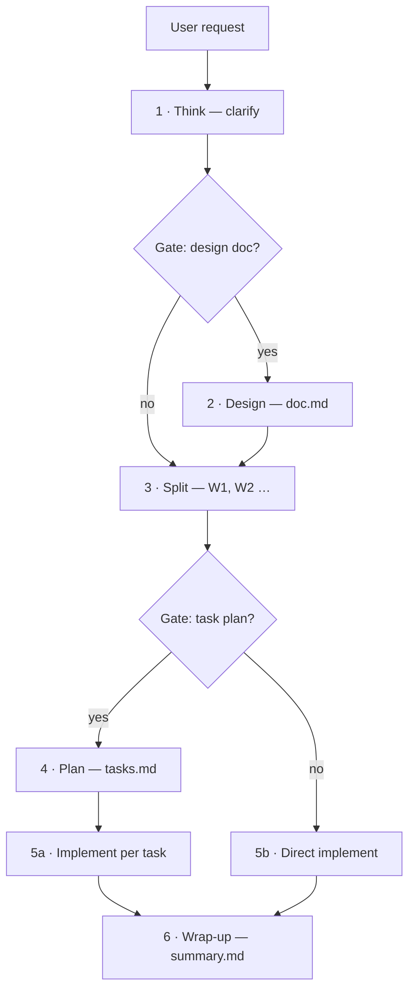

# spec-flow

**Stop your AI agent from writing code before the spec is clear.**

[中文文档](README.zh-CN.md)


A **spec-driven development workflow** skill for AI coding agents — Claude Code, Codex, Baidu Comate, Cursor, Gemini CLI and friends. It turns *"build me X"* into a gated pipeline — clarify → design → split → plan → implement → summarize — and lands a reviewable spec pack (`doc.md` / `tasks.md` / `summary.md`) on every feature.

No IDE plugin. No intranet tooling. Pure markdown that any agent platform can run.

## The failure modes it kills

Hand a multi-step feature to a coding agent and you'll hit one of these classics:

- 🫥 **Code before clarity** — the agent guesses the requirements and starts typing
- 📄 **Tasks split off a half-formed design** — the plan lives in the agent's head, nowhere else
- ✅ **"Done" without evidence** — no acceptance criteria, nothing to verify against

spec-flow makes all three *illegal*.

## The pipeline



Four hard rules the agent may not break:

1. **Think is non-skippable** — every code-touching task starts with clarification, not code.
2. **Design & plan are optional — but only you may skip them.** The agent never decides for you.
3. **Gates stop the agent.** At every gate it must ask out loud and wait for your answer.
4. **Uncertain → stop.** Ambiguity gets resolved by questions, never by guessing.

## The spec pack

| File | Stage | What it is |
| --- | --- | --- |
| `doc.md` | design | Requirements + technical design — the single source of truth for the solution |
| `tasks.md` | plan | Execution contract per work item: goal, scope, files, acceptance criteria, verify commands |
| `summary.md` | wrap-up | Issues, root causes, changed files, **real** verification results, follow-ups |

Everything lands in `<specs_root>/<feature_name>/`, where `specs_root` is auto-detected (existing `.comate/specs` → existing `specs` / `docs/specs` → creates `specs`).

## Why not just write a better prompt?

One-off prompts leak. spec-flow is a repeatable harness:

- **Judgment encoded, not vibes** — 6 reference files pin down exactly when the agent must stop and ask, the doc/task/summary templates, work-item split rules, and per-agent portability notes
- **Work items are commit-bound units** — `W2: fix offline fallback path` style, reviewable and revertible one by one
- **Independent review sub-agents** — each task runs builder → spec-compliance review → code-quality review; self-review can't stand in for review
- **Fresh evidence before "done"** — the agent must run the verify command and read the full output; *"should work"* is rejected by policy

## Install

Copy the folder into any agent's skills directory:

```bash
git clone https://github.com/IQQcode/spec-flow.git
cp -R spec-flow <your-agent-skills-dir>/
```

To make it available to **every** agent platform on your machine in one step, use [skill-unify](https://github.com/IQQcode/skill-unify):

```bash
git clone https://github.com/IQQcode/skill-unify.git ~/.agents/skills/skill-unify
python3 ~/.agents/skills/skill-unify/scripts/skill-unify install https://github.com/IQQcode/spec-flow --yes
```

## Trigger it

Say any of: *"spec 模式"*, *"按 spec 流程做"*, *"先写设计文档"*, *"先拆任务再实现"* — or simply hand the agent a multi-step feature request and let the skill description trigger it.

## Compatibility

Runs on any platform that supports the Skills convention (`SKILL.md` + `references/`): Claude Code, Codex, Baidu Comate, Cursor, Gemini CLI, Trae, Windsurf, and more. Per-agent differences are documented in [`references/portability.md`](references/portability.md).

## License

[MIT](LICENSE)
