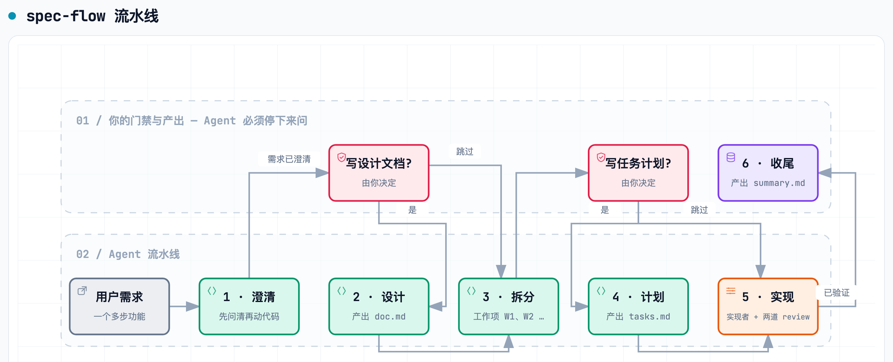

# spec-flow

**别再让你的 AI Agent 在需求没说清之前就开始写代码。**

[English](README.md)


一个**规格驱动的研发工作流** skill，适用于 Claude Code、Codex、百度 Comate、Cursor、Gemini CLI 等各类 AI 编码 Agent。它把「帮我做个 X」变成一条带门禁的流水线——澄清 → 设计 → 拆分 → 计划 → 实现 → 总结，并让每个功能都沉淀出可 review 的规格三件套（`doc.md` / `tasks.md` / `summary.md`）。

不依赖任何 IDE 插件或内网工具，纯 Markdown，任何 Agent 平台都能跑。

## 它消灭的三大经典翻车

把一个多步功能需求丢给编码 Agent，大概率撞上其中之一：

- 🫥 **需求没澄清就开写** — Agent 靠猜，猜完就动手
- 📄 **方案没落文档就拆任务** — 拆分只存在于 Agent 的脑子里
- ✅ **没有验收口径就宣称完成** — 谁也没法验证交付质量

spec-flow 让这三种状态**直接非法**。

## 主流程



Agent 不可逾越的四条硬规则：

1. **think 不可跳过** — 任何会改代码的任务都从澄清开始，不从改代码开始。
2. **design 与 plan 可选，但只能由你显式跳过** — Agent 不得替你决定。
3. **门禁处必须停下来问** — 问出声、等你答复，才能往下走。
4. **不确定即停** — 用提问解决歧义，绝不靠猜。

## 规格三件套

| 文件 | 阶段 | 作用 |
| --- | --- | --- |
| `doc.md` | design | 需求与技术方案，唯一的方案事实源 |
| `tasks.md` | plan | 面向执行者的任务契约：目标、范围、相关文件、验收标准、验证命令 |
| `summary.md` | 收尾 | 问题、根因、改动文件、**真实**验证结果、后续建议 |

产物统一落在 `<specs_root>/<feature_name>/`，`specs_root` 自动探测（已有 `.comate/specs` → 已有 `specs` / `docs/specs` → 都没有就新建 `specs`）。

## 为什么不是「提示词写好点就行」

一次性提示词会漏。spec-flow 是可复用的约束装置：

- **判断力被编码，而非靠感觉** — 6 个参考文件钉死了「何时必须停下来问」、doc/task/summary 模板、工作项拆分规则、各 Agent 落地差异
- **工作项是提交绑定的单位** — `W2: 补齐离线降级路径` 风格，逐项可 review、可回滚
- **独立的 review 子 Agent** — 每个 Task 顺序跑实现者 → 规格符合性 review → 代码质量 review；自审不能替代 review
- **「完成」必须有新鲜证据** — 必须跑验证命令并读完整输出；「应该可以」按策略直接拒绝

## 安装

把整个文件夹放进任一 Agent 的 skills 目录：

```bash
git clone https://github.com/IQQcode/spec-flow.git
cp -R spec-flow <你的skills目录>/
```

想一条命令同步到**全平台**，用 [skill-unify](https://github.com/IQQcode/skill-unify)：

```bash
git clone https://github.com/IQQcode/skill-unify.git ~/.agents/skills/skill-unify
python3 ~/.agents/skills/skill-unify/scripts/skill-unify install https://github.com/IQQcode/spec-flow --yes
```

## 触发方式

对 Agent 说：「spec 模式」「按 spec 流程做」「先写设计文档」「先拆任务再实现」，或直接丢给它一个多步功能需求，skill 描述会自动命中。

## 兼容性

任何支持 Skills 约定（`SKILL.md` + `references/`）的平台均可运行：Claude Code、Codex、百度 Comate、Cursor、Gemini CLI、Trae、Windsurf 等。各平台差异见 [`references/portability.md`](references/portability.md)。

## 许可证

[MIT](LICENSE)
