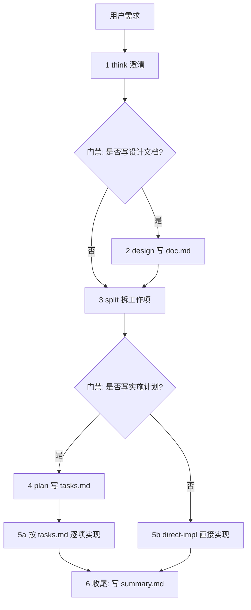

## 这个 skill 解决什么

多步研发任务里，Agent 最常见的失败是：需求没澄清就开写、方案没落文档就拆任务、任务没有验收口径就宣称完成。

本 skill 把研发过程固定成六个阶段，每个阶段有明确产物和门禁。产物统一落在 `<specs_root>/{feature_name}/`：

| 文件 | 阶段 | 作用 |
| --- | --- | --- |
| `doc.md` | design | 需求与技术方案，唯一的方案事实源 |
| `tasks.md` | plan | 面向执行者的任务契约，含验收标准与验证命令 |
| `summary.md` | 收尾 | 问题、根因、结论、改动文件、验证结果、后续建议 |

`specs_root` 按项目探测，优先级：已存在的 `.comate/specs` → 已存在的 `specs` 或 `docs/specs` → 都不存在时新建 `specs`。
`feature_name` 用简短小写英文加下划线，可带版本前缀，例如 `22_11_agile_card`、`mac_app_shell`。

## 主流程

四条硬规则：

1. **think 不可跳过。** 任何会改代码的任务都从澄清开始，不从改代码开始。
2. **design 与 plan 可选，但必须由用户显式选择。** 不要替用户决定，也不要选了之后草草敷衍。
3. **门禁处必须停下来问。** 有结构化提问工具就用它给出两个选项，没有就用编号列表让用户回一个数字。
4. **不确定即停。** 任何阶段命中「必须提问的信号」时，先问清再动手，不靠猜测往下走。判定清单与提问格式见 `references/clarify-gate.md`。

## 阶段 1：think 澄清（必做）

目标是把原始想法收敛成可以进入研发的清晰需求，不写文档，不改代码。

1. 探索项目上下文：读 README、AGENTS.md / CLAUDE.md、目录结构、最近提交。只读到足够理解需求为止，不做完整架构设计。
2. 用户提供了 PRD、链接、本地文档、卡片时，先派子 agent 提炼与本次变更直接相关的信息。保留原始来源，材料里没有的内容不要编造。
3. 提澄清问题：按 `references/clarify-gate.md` 的信号清单判断该问什么，只问会影响需求理解、方案选择或拆分边界的问题。合并互不依赖的问题，减少来回轮次。仍有影响判断的不确定项时继续问，不要急着往下走。
4. 只在存在真实分歧时给 2 到 3 个方案，说明差异和代价，不要为凑数编方案。
5. 展示一段轻量的「当前理解」，不写成长文。

门禁提问：进入 design 写方案文档，还是跳过 design 直接拆分。

## 阶段 2：design 写 doc.md（可选）

只解决方案不确定性，不拆工作项，不写代码。

1. 补充调研，不重复整个 think。可并行派两个子 agent：一个查架构文档与既有约束，一个从已知路径深挖代码结构、调用链和数据流。已给出路径时禁止无关全仓扫描。
2. 按 `references/doc-template.md` 写入 `<specs_root>/{feature_name}/doc.md`。
3. 调研后仍有方案分歧或关键事实无法确认时，回到提问，不要在文档里用「待定」占位掩盖不确定性。判定见 `references/clarify-gate.md`。
4. 自审或派 reviewer 审查，重点看能否支撑后续拆分与实现。发现会影响下游的问题就改文档再审。
5. 请用户 review：确认设计则进入 split，要求修改则改完重审。

文档风格：架构与数据流用 mermaid，不用 ASCII 图；不贴完整实现代码，只留关键签名、数据结构或配置示例；严格 YAGNI。

## 阶段 3：split 拆工作项（必做）

把需求拆成若干工作项。工作项是实现单元和提交绑定单位，编号用 `W1`、`W2`。

每个工作项必须满足：

1. 有明确可验收交付物，不是「开发某模块」这类描述
2. 可独立开发，不需要等别的工作项的代码
3. 单一职责，一个端或一条业务链路，不跨端不跨链路
4. 标注是改造现有模块还是新增模块
5. 标注关注文件与目录

拆分判断：

| 条件 | 动作 |
| --- | --- |
| 同一业务链路的连续步骤 | 合并 |
| 存在代码依赖 | 合并 |
| 拆完粒度过小 | 合并 |
| 技术栈不同且可独立交付 | 分开 |
| 跨端，例如前端与服务端 | 分开 |

拆分结果必须先展示再落地，展示格式见 `references/split-format.md`。用户确认前不要动代码。

拆分时发现需求边界不清、某模块归属存疑、或某个工作项无法定出验收口径，先按 `references/clarify-gate.md` 问清再拆，不要先拆出一个模糊工作项占位。

工作项清单落在 `doc.md` 的工作项拆分章节，`tasks.md` 引用其编号，提交信息前缀带上编号，例如 `W2: 补齐离线降级路径`。跳过 design 时清单直接落在 `tasks.md` 头部。

项目自带 issue tracker 且用户明确要求同步时，可把工作项登记为对应平台的条目，编号换成平台 ID。这是可选增强，本 skill 不内置任何平台的字段约定或层级规范。

门禁提问：进入 plan 写 tasks.md，还是跳过 plan 直接实现。

## 阶段 4：plan 写 tasks.md（可选）

把已确认的工作项转写成执行契约，不重新拆分。

1. 一个工作项对应一个 Task，禁止一拆多或多合一
2. 每个 Task 补齐目标、上下文、范围、相关文件、验收标准、测试预期、约束
3. 模板见 `references/tasks-template.md`

自审红线，出现即视为计划失败：`TBD`、`TODO`、`稍后实现`、`补充细节`；「加上合适的错误处理」但没说哪些错误重要；「写测试」但没有具体行为、命令和预期结果；「同 Task N」但没重复必要上下文；引用了任何任务里都没定义的类型或函数。

红线的正确解法是提问，不是换个说法绕过。写不出具体验收标准或验证命令，说明信息还不够，按 `references/clarify-gate.md` 问清再写。

请用户 review：确认计划则进入实现，要求修改则改完重审。

## 阶段 5：实现

实现前先查工作区安全：`git status --short --branch -uall`。已修改、已暂存、未跟踪文件都视为用户的工作，可以读取纳入判断，但不得移动、覆盖、清理、丢弃或 stash，除非用户在当前轮明确批准。当前分支是 main 或 master 且用户没明确许可时，先建隔离分支或 worktree。

### 5a 有 tasks.md：逐项派子 agent

每个 Task 顺序派三个独立子 agent，实现者的自审不能替代 review，代码质量 review 不能替代规格符合性 review：

1. 实现者：实现、测试、提交、自审、报告状态
2. 规格符合性 reviewer：核对目标、范围、验收标准、约束
3. 代码质量 reviewer：仅在规格符合性通过后进行

实现者状态处理：`DONE` 进入 review；`DONE_WITH_CONCERNS` 先读疑虑，涉及正确性或范围的先解决；`NEEDS_CONTEXT` 补上下文后 resume；`BLOCKED` 判断是上下文不足、任务过大还是计划有误，分别补上下文、拆小、上报用户。不要在毫无调整的情况下让子 agent 重试。

禁止：没有阻塞就中途退出循环；对可能改同一批文件的任务并行派实现者；让子 agent 自己去读整份计划而不给精确任务文本；跳过任一 review 阶段；把「差不多」当通过。

### 5b 无 tasks.md：直接实现

按工作项顺序实现，每个工作项开始前确认目标与验收口径、范围内外、关注文件、验证方式。只改当前工作项所需内容，不借机重构无关代码，不反向补写 `tasks.md`。

### 验证与自审（两条路径都必须做）

声明完成、提交或进入下一项之前，必须有本轮的新鲜验证证据：优先跑工作项或项目文档指定的命令，没有就从项目上下文选最小可信命令，跑完整命令并读完整输出与退出码，跑不了就说明原因并给替代验证。禁止用「应该可以」「大概没问题」宣称完成。

自审五问：是否满足验收口径；是否有范围漂移或无关重构；是否符合现有代码模式；是否引入未知标识符、依赖、生成物漂移或安全风险；是否只包含当前工作项应有的改动。

实现过程中撞上计划没覆盖的岔路时停下来问，不要自行扩大范围。触发条件按 `references/clarify-gate.md`，其中「改动会触及不可逆或外部可见的东西」在实现阶段尤其要守住：删文件、改数据结构、动线上配置、改鉴权、推远端之前必须先拿到用户确认。

## 阶段 6：收尾

1. 按 `references/summary-template.md` 写 `<specs_root>/{feature_name}/summary.md`
2. 验证结果用 checkbox，没做到的项保持未勾选并写明原因，不要假装全绿
3. 有 specs 索引文件时更新索引
4. 用 worktree 或临时分支时，给出 rebase 后清理、保留分支、丢弃三种收尾选项让用户选，不要自行删分支

## 参考文件

| 文件 | 用途 |
| --- | --- |
| `references/clarify-gate.md` | 不确定即停：必须提问的信号、可自行决定的事、提问格式 |
| `references/doc-template.md` | `doc.md` 章节模板 |
| `references/tasks-template.md` | `tasks.md` 头部与 Task 契约模板 |
| `references/summary-template.md` | `summary.md` 模板 |
| `references/split-format.md` | 拆分结果展示格式与门禁提问话术 |
| `references/portability.md` | 与 Comate mission-flow 的对应关系，以及各 Agent 落地差异 |
